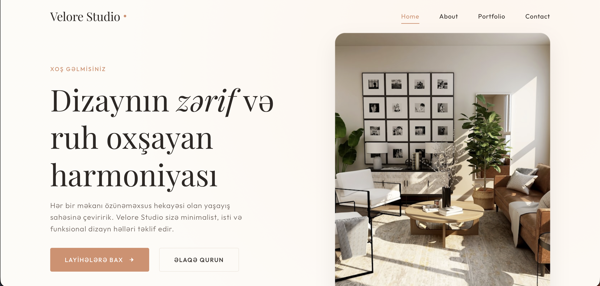

# Velore Studio – Interior Design Studio Website

A multi-page website for a fictional interior design studio, built with HTML, CSS and vanilla JavaScript. Site content is in Azerbaijani.

**Live demo:** https://tutu-creator.github.io/Velore-Studio/

## Features
- Multi-page structure: Home, About, Portfolio, Contact
- Portfolio filtering by category with smooth transition animations
- Contact form validation (name, email format, message) with success and error messages
- Testimonials slider with auto-play and previous/next controls
- Sticky header that changes style on scroll
- Mobile hamburger menu with scroll lock while open
- Fully responsive design for mobile, tablet and desktop
- Basic SEO: meta description and descriptive image alt texts

## Built With
- HTML5
- CSS3
- JavaScript (vanilla)
